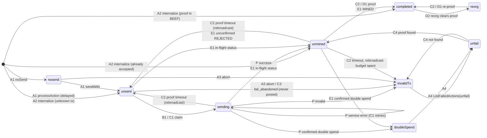
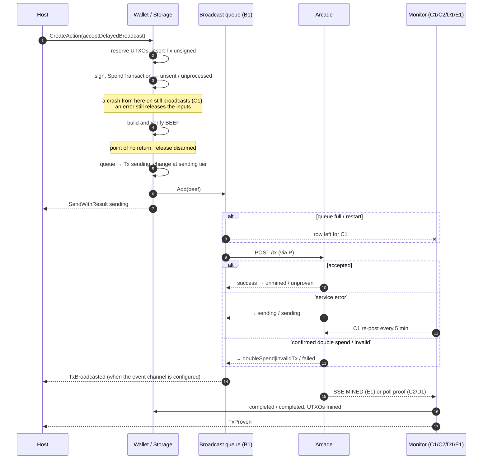
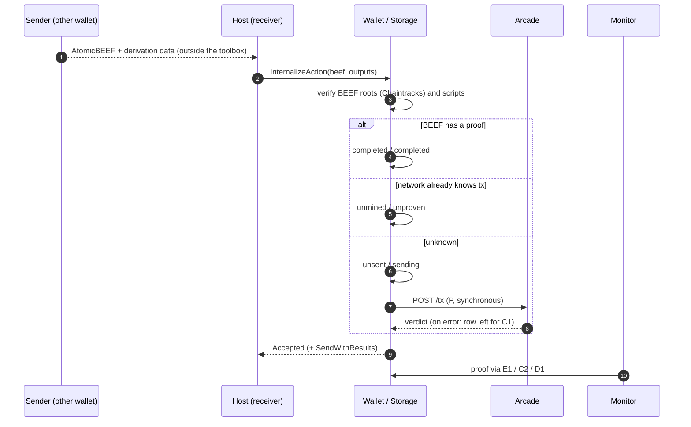
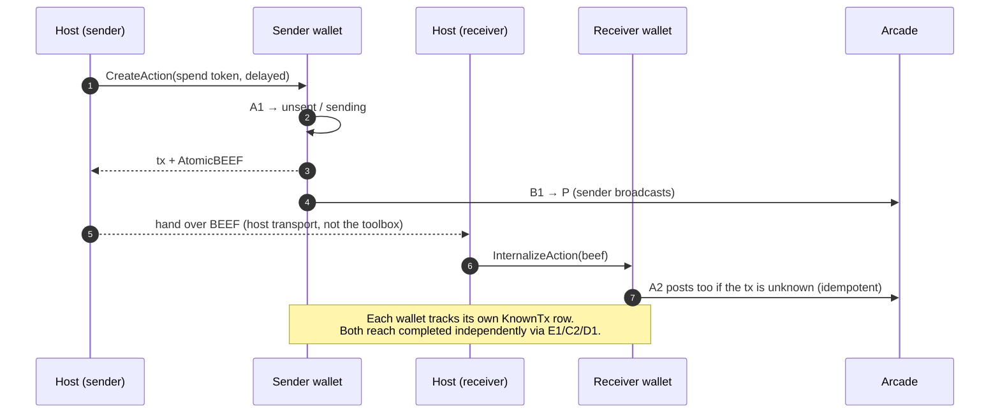
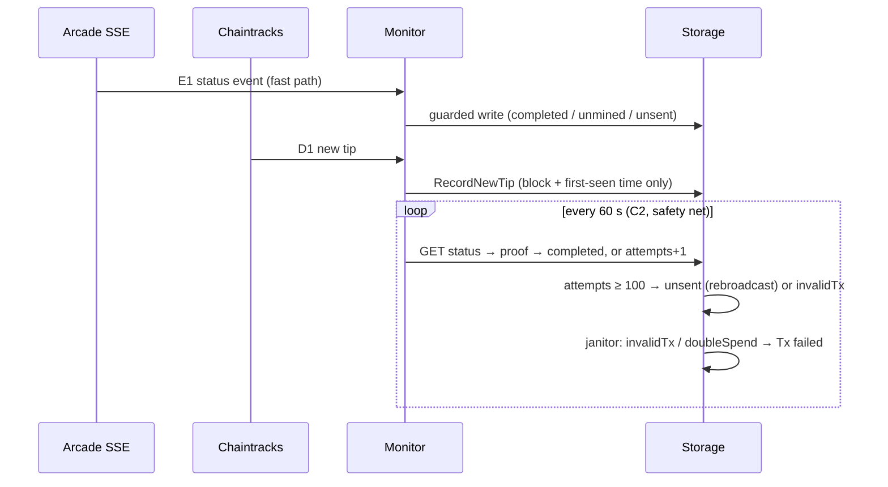
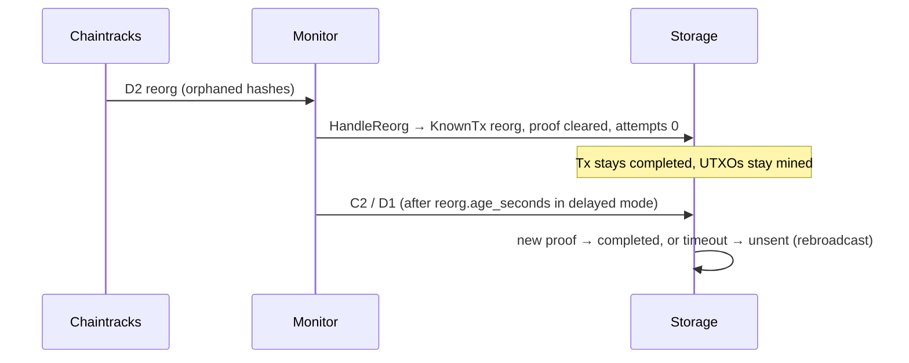
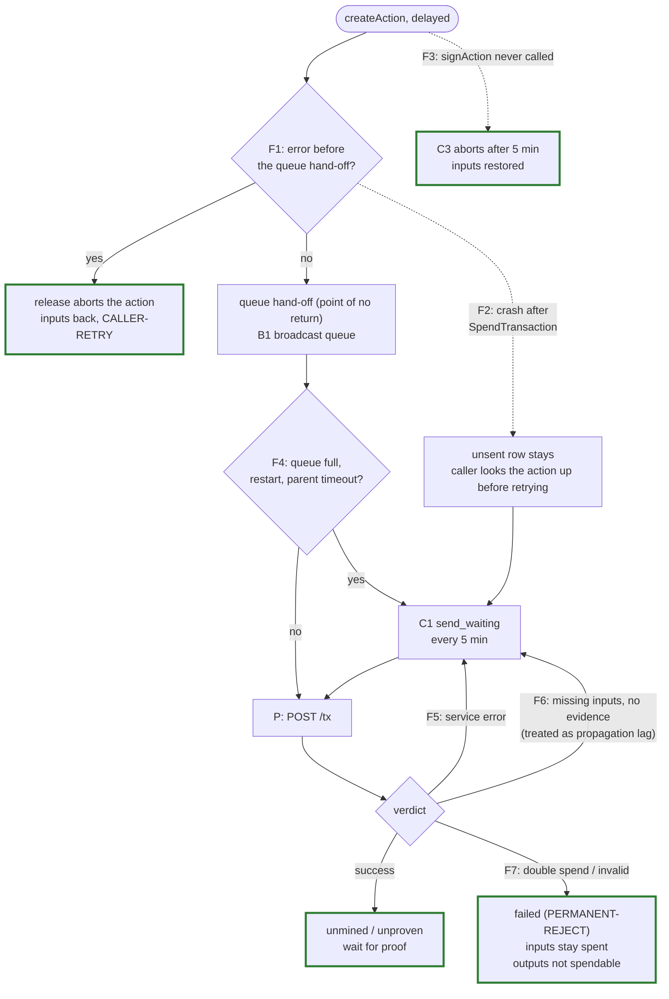
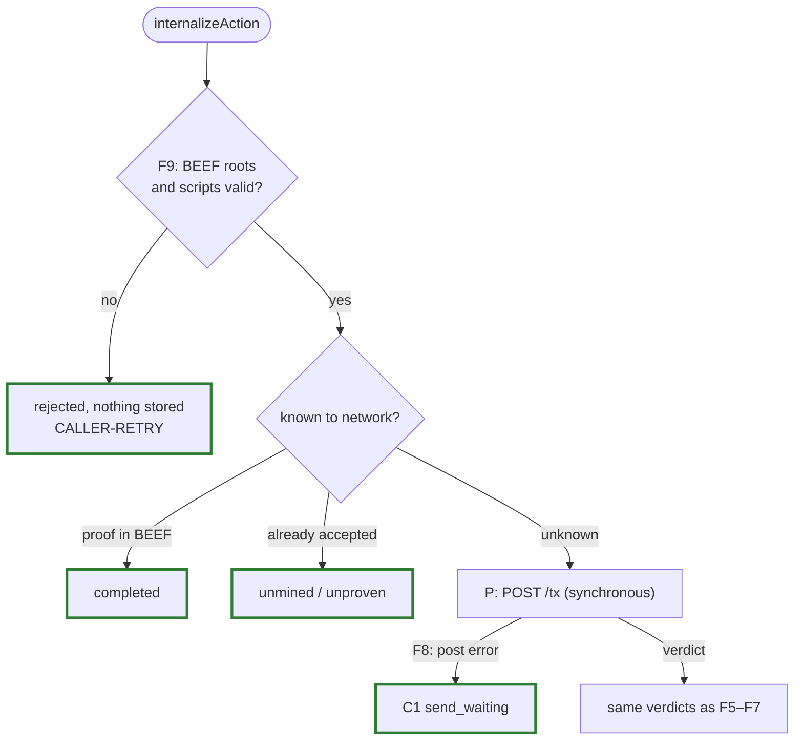
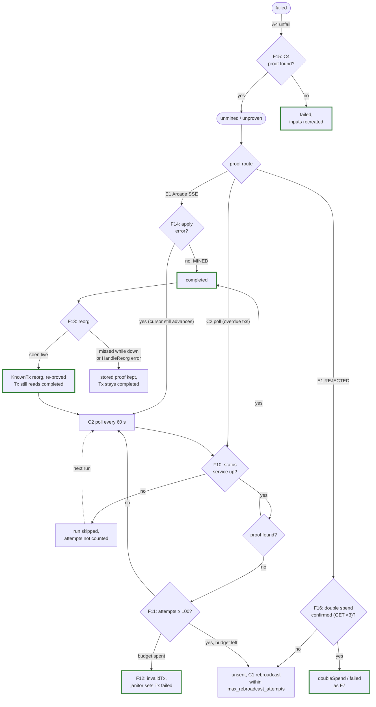
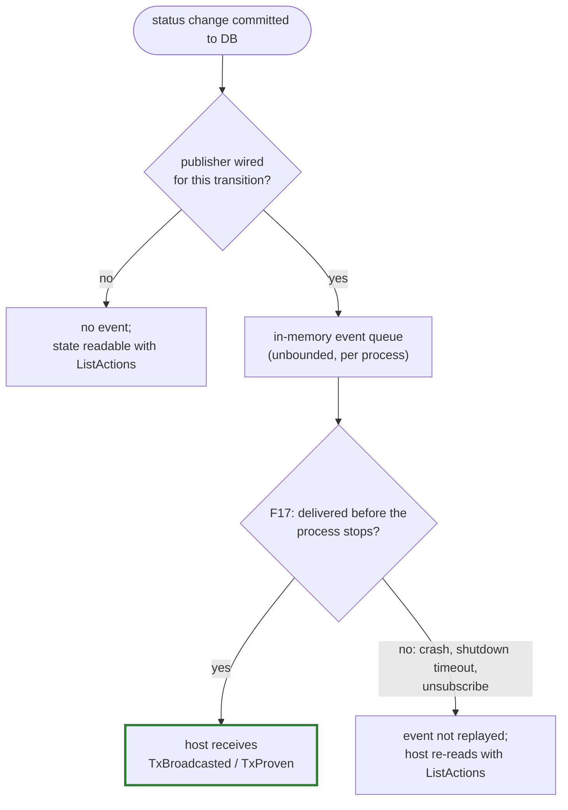

## TX LIFECYCLE: BSV Wallet Toolbox

This page maps every sequence that moves a transaction through the toolbox. It covers
what triggers each sequence, what the sequence writes, where a transaction waits, what
wakes it, and how each failure ends. An operation the toolbox has accepted ends in, or
is on its way to, one of three outcomes:

- **mined**: the tx is in a block and its proof is stored;
- **permanently rejected**: KnownTx `invalidTx`/`doubleSpend`, Tx `failed`;
- **temporarily failing**: the tx is left for a timer to retry.

Scope and conventions:

- **Delayed broadcast only** (`acceptDelayedBroadcast: true`). Immediate mode runs the
  same post-and-verdict sequence ([P](#p-post-and-verdict)) on the caller's thread and is
  not described separately.
- Statuses are written as **KnownTx / Tx**: `known_txs.status` / `transactions.status`.
  The enums live in [`pkg/wdk/tx_status.go`](../pkg/wdk/tx_status.go).
- Behavior is described as of `main` @ `7a19a8a1`, with Arcade as the primary
  broadcaster and Chaintracks for headers.
- Related pages: [`utxo-lifecycle.md`](./utxo-lifecycle.md) covers the repository calls
  and the release machine. [`monitor.md`](./monitor.md) covers task configuration and
  reorg modes.

 

### Contents

1. [Statuses](#statuses)
2. [Triggers](#triggers)
3. [Operation sequences](#operation-sequences)
4. [Sleep points](#sleep-points)
5. [Failure categories](#failure-categories)
6. [Failure points](#failure-points)

 

### Statuses

The Tx status follows the KnownTx status:

| KnownTx | Tx | Standardized (host-facing) |
|---|---|---|
| — (createAction, before signing) | `unsigned` | waiting |
| `unsent` | `unprocessed` → `sending` | waiting |
| `sending` | `sending` | waiting |
| `nosend` | `nosend` | waiting |
| `unmined` | `unproven` | broadcasted |
| `completed` | `completed` | mined |
| `reorg` | `completed` (unchanged while the proof is re-collected) | mined |
| `invalidTx` / `doubleSpend` | `failed` | invalidTx |
| `invalidTx` (parked by an abort) | `aborted` | aborted |
| `unfail` | `failed` (until C4 decides) | invalidTx |

 

### Triggers

Every change to a transaction starts from one of six kinds of trigger. Rows hand work to
each other: `→ P` means the row runs the shared post-and-verdict sequence, and `→ C1`
means the row is left for `send_waiting` to pick up.

#### Wallet API call (caller thread)

| ID | Trigger | Sequence | Writes | Hands off |
|---|---|---|---|---|
| **A1** | `CreateAction` (signAndProcess), or `CreateAction` + `SignAction` | Reserve UTXOs → insert Tx `unsigned` and its outputs → sign → nLockTime final? → `SpendTransaction` (KnownTx `unsent`, Tx `unprocessed`) → verify scripts → `queueTxForDelayedBroadcast` (Tx `sending`, change indexed at the `sending` tier) → `backgroundBroadcaster.Add` | Inputs reserved, then marked spent. An error before `SpendTransaction` commits fires the release guard, which puts the inputs back. | → B1, or → C1 if the queue is full. noSend: `nosend`/`nosend`, stops here until a later call names it in `sendWith`, which queues it like any other tx. |
| **A2** | `InternalizeAction`: incoming AtomicBEEF (funding top-up via wallet payment, or a token via basket insertion) | Verify BEEF roots and scripts → store Tx and outputs in the target basket → known? | Proof in BEEF → `completed`/`completed`. Already accepted → `unmined`/`unproven`. Unknown → `unsent`/`sending`. | Unknown: posts synchronously → P. A post error is returned in the result and the row → C1. |
| **A3** | `AbortAction` | Find action → never posted? (`was_broadcast=false`, `attempts=0`) → park KnownTx | KnownTx `invalidTx`, Tx `aborted`. Inputs restored, reservations dropped, created outputs not spendable. | If it was already posted: error, nothing changes. |
| **A4** | `ListFailedActions(unfail=true)` | Find failed actions → flag them | KnownTx `unfail`; Tx stays `failed`. | → C4 |
| **A5** | `RelinquishOutput` | Unlink the output from its basket | No status change. | — |

#### Internal handoff (in-memory queue)

| ID | Trigger | Sequence | Writes | Hands off |
|---|---|---|---|---|
| **B1** | Delayed queue item. 10 workers, queue of 1000. | Unmined parent posted? A parent this pool was not asked to post is looked up in the database: if it is not waiting to be sent, the child goes ahead. Otherwise the child waits (up to 30 s for a parent this pool posts, 500 ms for one left to C1) and is **never posted ahead of its parent** → re-claim (`ClaimKnownTxsForBroadcast`) → post | `sending`, `was_broadcast=true`, `attempts+1`. `TxBroadcasted` event when the provider is built with `WithBackgroundBroadcasterChannel`. | → P. Queue full, parent wait expired, parent's post failed, post error or restart → C1. |
| **P** | Post and verdict, shared by A2, B1 and C1 | Circuit breaker open? → `POST /tx` (Arcade; ARC → WhatsOnChain → Bitails on transport failure) → double spend reported? confirm with `GET` ×3, 1 s apart → verdict | Success → `unmined`/`unproven` and change UTXOs created. Confirmed double spend → `doubleSpend`/`failed`. Invalid → `invalidTx`/`failed`. In both failure cases created outputs are not spendable and **inputs are not restored**. Service error → `sending`/`sending`. | Service error → C1 |

#### Timer (monitor daemon; with the GORM lease locker only one instance runs each task)

| ID | Trigger | Sequence | Writes | Hands off |
|---|---|---|---|---|
| **C1** | `send_waiting`: every 5 min, for rows at least 5 min old. At start-up it takes rows of any age. | Find KnownTx `unsent` + `sending` → claim → post per batch | as P. `TxBroadcasted` event. | → P |
| **C2** | `check_for_proofs`: every 60 s, at most once per block, only for txs with ≥ `proof_check_after_blocks` (2) blocks seen since broadcast | Tip → block already checked? → overdue txs only → `GET` status at depth ≥ `blocks_delay` → merkle path → timeout? → janitor (`reviewKnownTxStatuses`) | Proof → `completed`/`completed`, UTXOs move to `mined`. No proof → `attempts+1`. At `attempts ≥ 100`: if posted → `unsent` (rebroadcast; budget `max_rebroadcast_attempts`, 0 = unlimited), otherwise `invalidTx`. Janitor: `invalidTx`/`doubleSpend` → Tx `failed`. `TxProven` event (the janitor writes emit none). | Timeout → C1 |
| **C3** | `fail_abandoned`: every 5 min, rows older than 5 min | Find Tx `unsigned`, or Tx `unprocessed` whose KnownTx is `unprocessed` or missing → outputs unspent? → abort | as A3. No event. | — |
| **C4** | `un_fail`: every 10 min | Find `unfail` → merkle path? | Found → `unmined`/`unproven`, outputs and UTXOs restored. Not found → `invalidTx`/`failed`, **inputs recreated**. No event. | — |
| **C5** | Circuit breaker health probe: every 30 s while the breaker is open | `GET /health` | Healthy → breaker closes and Arcade is primary again. | — |

#### Chaintracks event (monitor goroutine)

| ID | Trigger | Sequence | Writes | Hands off |
|---|---|---|---|---|
| **D1** | New tip | `ProcessNewTip`: records the block and the time it was first seen (newest `proof_check_after_blocks` blocks, key-value store). No polling. | — | — |
| **D2** | Reorg (orphaned block hashes) | `HandleReorg` → `InvalidateMerkleProofsByBlockHash` | KnownTx `reorg`, proof cleared, `attempts=0`. Tx stays `completed`. No event. On error: logged only. | Re-proved by C2/D1, at once or after `reorg.age_seconds` |

#### Arcade SSE event (monitor goroutine, 8 apply workers)

| ID | Trigger | Sequence | Writes | Hands off |
|---|---|---|---|---|
| **E1** | Status event, resumed from the saved cursor | Known and not terminal? → status? → merkle root valid? → REJECTED: confirm with `GET` ×3 | In flight → `unmined`/`unproven`. MINED → `completed`/`completed`. Confirmed double spend → `doubleSpend`/`failed`. Unconfirmed REJECTED → `unsent` (or `invalidTx` once the rebroadcast budget is spent). `TxProven` event. Cursor saved after each batch, **including when an apply fails**. | Unconfirmed → C1 |

#### Process start-up

| ID | Trigger | Sequence | Writes | Hands off |
|---|---|---|---|---|
| **F1** | Start the services and the daemon | Start broadcaster workers → open SSE at the saved cursor → subscribe to tips and reorgs → schedule timers | — | Arms B1, C1–C5, D1–D2, E1. C1 runs at once and recovers the in-memory queue lost at shutdown. Reorgs that happened while the process was down are not replayed. |

 

### Operation sequences

#### Create, sign and broadcast (delayed)

#### Funding top-up and token receive (InternalizeAction)

Both are the same call. A funding top-up uses the wallet payment protocol (the output goes
to the change basket). A token uses basket insertion (the output goes to a named basket).

#### Token transfer between wallets (sender and receiver)

If the sender's broadcast is rejected, the receiver's row receives the same verdict from
its own post or from proof polling. Neither side is told about the other side's outcome.

#### Proof collection

E1 and C2/D1 share guarded writes, so whichever lands first wins and the other does
nothing.

#### Reorg

 

### Sleep points

Every place where an operation rests in a non-final status, and what wakes it:

| Rests in (KnownTx / Tx) | Woken by | Normal wait | If the waker never fires |
|---|---|---|---|
| — / `unsigned` (pending `SignAction`) | caller `SignAction`; C3 | caller-defined | C3 aborts after 5 min, inputs restored |
| `unsent` / `unprocessed` (crash inside `processAction`) | C1 | ≤ 5 min | still broadcasts (point of no return already passed) |
| `unsent` / `sending` (in queue) | B1 worker | ms | C1 after a restart or overflow, ≤ 10 min |
| `sending` / `sending` (service error) | C1 | 5 min per retry | retried by C1 until accepted; the C2 proof timeout and `max_rebroadcast_attempts` (0 = unlimited) apply once it is posted |
| `unmined` / `unproven` | E1 MINED; D1 new tip; C2 every 60 s | 1 block | after 100 C2 attempts (≈100 min) → rebroadcast, up to `max_rebroadcast_attempts`, then `invalidTx` |
| `reorg` / `completed` | C2 / D1 (after `age_seconds`) | 1 block | Tx reads `completed` until the new proof is stored |
| `unfail` / `failed` | C4 | ≤ 10 min | stays `unfail` |
| `nosend` / `nosend` | caller (`sendWith`, abort); C2 once per 24 h | caller-defined | inputs stay reserved forever (outside delayed mode) |

 

### Failure categories

Each failure point below falls into one of four categories:

| Category | Meaning | What happens |
|---|---|---|
| **CALLER-RETRY** | The API call returned an error before the point of no return (the queue hand-off). | The release aborts the action and restores its inputs (see [release compensation](./utxo-lifecycle.md#release-compensation)). The caller may retry. A *crash* after `SpendTransaction` commits still broadcasts, so a caller that retries after a crash looks the action up first (for example by its label). |
| **AUTO-RETRY** | A transient failure. | The toolbox retries on a timer (C1 re-posts, C2 re-checks). |
| **STALLED** | No forward progress until an outside condition changes. | Work resumes when the service is back or the process restarts. |
| **PERMANENT-REJECT** | The network rejected the tx. | KnownTx `invalidTx`/`doubleSpend`, Tx `failed`. Inputs stay spent, to guard against a false double-spend verdict; created outputs are marked not spendable. |

 

### Failure points

| # | Where | What fails | Category | Ends in | Outputs and events |
|---|---|---|---|---|---|
| F1 | A1 error before the queue hand-off | funding, signing, nLockTime, BEEF or script verification, DB | CALLER-RETRY | action `aborted` by the release (nothing stored if funding failed) | inputs restored |
| F2 | A1 crash after `SpendTransaction`, or error after the queue hand-off | process dies, queue write fails | AUTO-RETRY (C1) | broadcast proceeds | the tx is broadcast; a retrying caller looks the action up first |
| F3 | A1 `SignAction` never called | caller crash | CALLER-RETRY | C3 → `aborted` | inputs restored; no event is published for the abort |
| F4 | B1 queue full / restart / parent wait expired | in-memory loss | AUTO-RETRY (C1) | as P | none (overflow metric exists) |
| F5 | P transport / service error | Arcade or fallbacks down | AUTO-RETRY (C1, breaker C5) | `sending` until accepted | retried by C1; the breaker (C5) switches back to Arcade when it recovers |
| F6 | P "missing inputs" without evidence | parent not propagated, **or parent rejected** | AUTO-RETRY | `sending`, retried by C1 | treated as propagation lag, so it is kept retryable rather than failed |
| F7 | P confirmed double spend / invalid | bug or conflict | PERMANENT-REJECT | `doubleSpend`/`invalidTx` + `failed` | inputs stay spent; created outputs not spendable; `TxBroadcasted` when the event channel is configured |
| F8 | A2 post error | broadcaster down | AUTO-RETRY (C1) | as P | none |
| F9 | A2 BEEF invalid | bad counterparty data | CALLER-RETRY (reject) | nothing stored | none |
| F10 | C2 status service down | `GET` fails | STALLED | run skipped, `attempts` not incremented | the next run tries again |
| F11 | C2 proof timeout | not mined after 100 checks | AUTO-RETRY (rebroadcast) | `unsent` → C1, loops | rebroadcast up to `max_rebroadcast_attempts` (0 = unlimited), then `invalidTx` |
| F12 | C2 janitor → Tx `failed` | after a timeout or E1 `invalidTx` | PERMANENT-REJECT | `failed` | written by the janitor, which publishes no event |
| F13 | D2 missed (process down) or `HandleReorg` error | event lost | STALLED | stale proof kept, `completed` | the stored proof is kept |
| F14 | E1 apply error | DB error, deadlock after retries | AUTO-RETRY (C2 backstop) | as C2 | none (cursor advances; polling recovers) |
| F15 | C4 not found | a once-failed tx is still absent | PERMANENT-REJECT | `failed`, inputs recreated | inputs recreated; no event is published |
| F16 | E1 `REJECTED` after the tx was accepted | evicted, or double spent later | confirmed: PERMANENT-REJECT; unconfirmed: AUTO-RETRY (C1) | `doubleSpend` + `failed`, or `unsent` → re-post | confirmed: as F7. Unconfirmed: re-posted within the rebroadcast budget |
| F17 | Event delivery to the host | crash, shutdown timeout, or the host unsubscribes with events still buffered | STALLED | DB state is correct; the event is gone | the host re-reads the action with `ListActions` |

#### Failure paths: submit and broadcast (F1–F7)

A green border marks where a path ends. Every retry loop goes back through `send_waiting` (C1).

#### Failure paths: receive (F8–F9)

#### Failure paths: proofs, reorg and re-check (F10–F16)

#### Failure paths: event delivery (F17)

