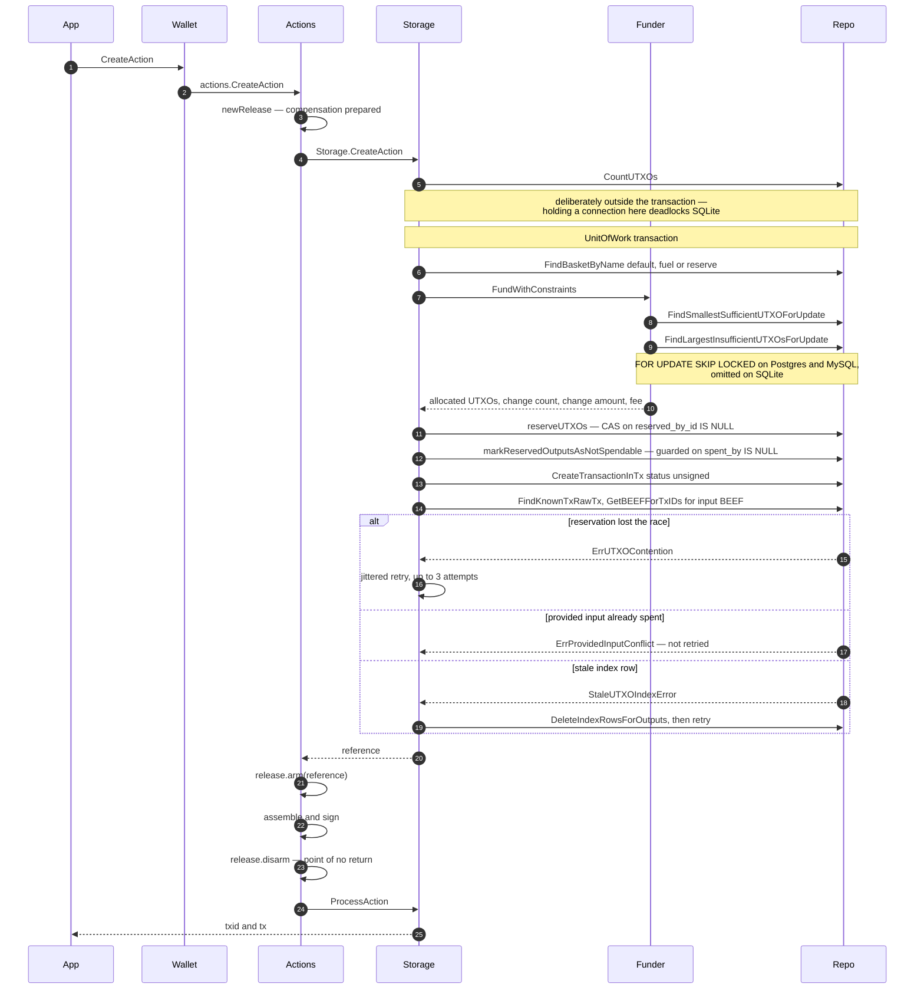
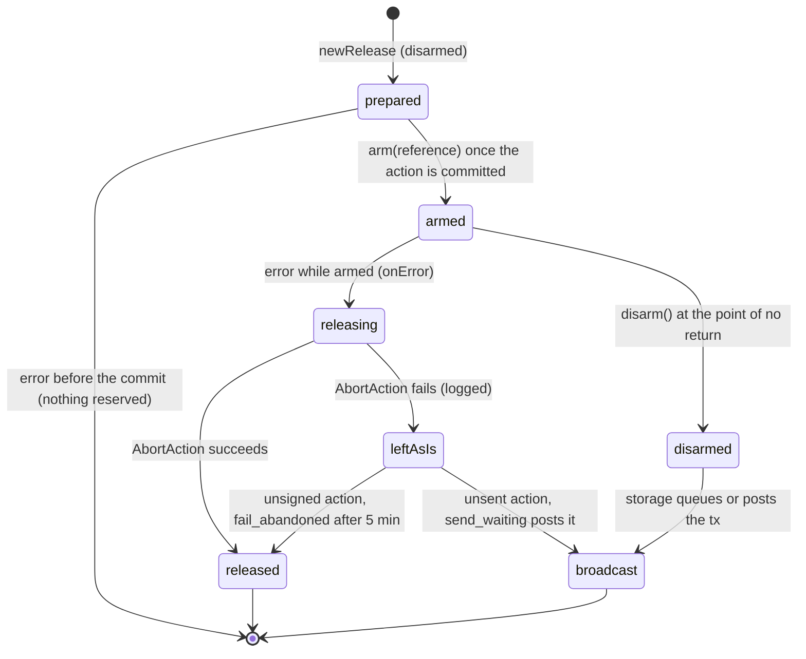
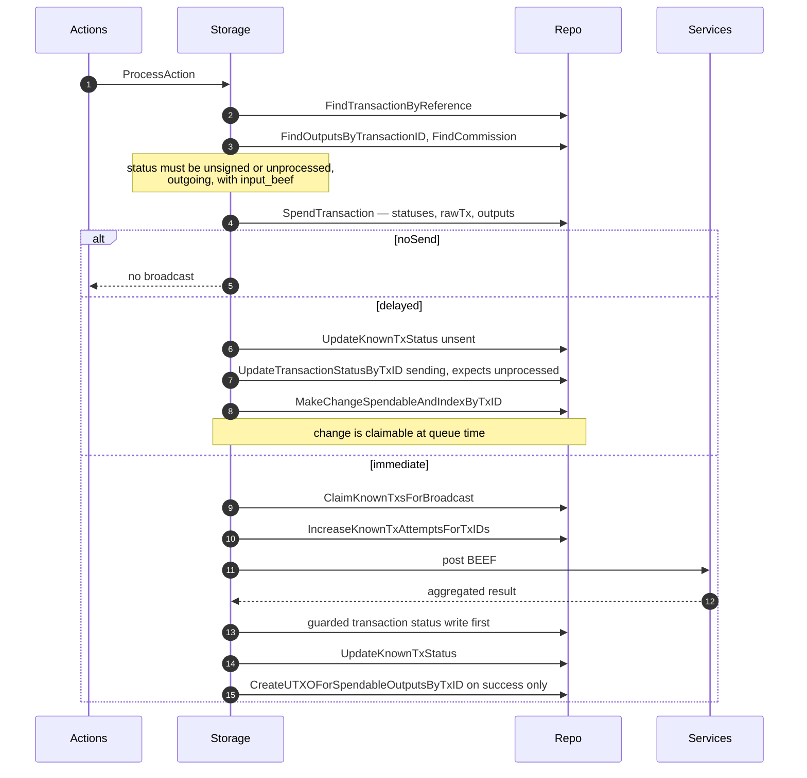
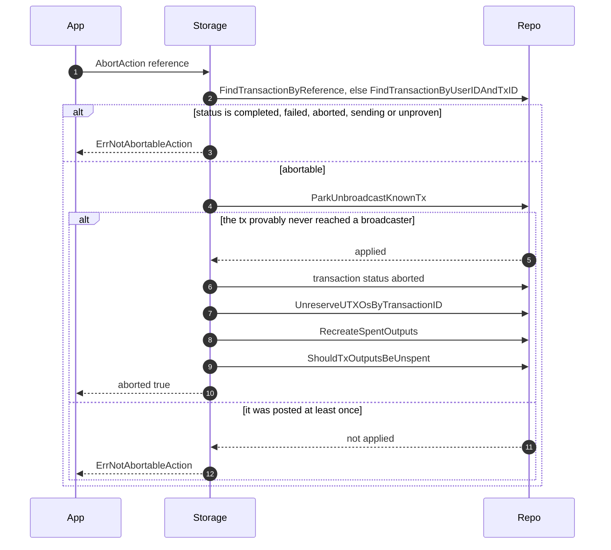

## UTXO LIFECYCLE: BSV Wallet Toolbox

This page traces a transaction through the BRC-100 wallet interface as implemented here:
which layer does what, which repository calls each method makes, and what state the
transaction and its outputs are left in.

The cross-implementation view — the same lifecycle described against the BRC-100
specification with the TypeScript implementation side by side — lives in
[`ts-stack/docs/architecture/wallet-utxo-lifecycle.md`](https://github.com/bsv-blockchain/ts-stack/blob/main/docs/architecture/wallet-utxo-lifecycle.md).
This page is the Go-specific half: the repository layer, the two-phase UTXO reservation,
and the release compensation machine, none of which have TypeScript counterparts.
The trigger-by-trigger map of status transitions and failure paths is in
[`tx-lifecycle.md`](./tx-lifecycle.md).

### Layers

| Layer | Package |
|---|---|
| Wallet | `pkg/wallet/wallet.go` — BRC-100 surface, asserts `sdk.Interface` |
| Actions | `pkg/wallet/internal/actions/` — create/sign orchestration, release compensation |
| Manager | `pkg/storage/storage_manager.go` — auth injection, active/backup routing |
| Provider | `pkg/storage/provider.go` — implements `wdk.WalletStorageProvider` |
| Storage actions | `pkg/storage/internal/actions/` — create, process, abort, internalize, list |
| Funder | `pkg/internal/storage/funder/` — coin selection |
| Repo | `pkg/internal/storage/repo/` — SQL, reservations, guarded status writes |
| Monitor | `pkg/monitor/` — background convergence |

The seam that matters is `pkg/storage/internal/actions/repos.interface.go`: `BasketRepo`,
`OutputRepo`, `TransactionsRepo`, `KnownTxRepo`, `UTXORepo`, `CommissionRepo`,
`KeyValueRepo`, and the `UnitOfWork` that runs them in one database transaction.

### CreateAction

### Reservation is two-layered

`bsv_user_utxos` is the funder's claim index; `bsv_outputs` is spend truth. They move
independently inside the same transaction and fail for different reasons.

| Write | Guard | Failure |
|---|---|---|
| `reserveUTXOs` sets `reserved_by_id` | `reserved_by_id IS NULL` | row-count mismatch → `wdk.ErrUTXOContention`, retried |
| `markReservedOutputsAsNotSpendable` sets `spendable=false, spent_by` | `spent_by IS NULL` | `StaleUTXOIndexError` or `repo.ErrProvidedInputConflict`, not retried |

Only `ErrUTXOContention` is retried, because it means another `CreateAction` won a fair
race. `ErrProvidedInputConflict` means the caller asked to spend something already spent,
which no retry can fix.

Index rows are created when a change output is made spendable, promoted by
`MakeChangeSpendableAndIndexByTxID` or `CreateUTXOForSpendableOutputsByTxID`, restored by
`RecreateSpentOutputs`, and deleted on successful spend or on relinquish. The partial
index `idx_user_utxos_claim` covers `WHERE reserved_by_id IS NULL`, which is the claim
path.

### Release compensation

Building a transaction is not one atomic step. Storage first commits the action with its
inputs **reserved** (`CreateAction`). The wallet then assembles and signs it, and storage
writes and queues it (`ProcessAction`). If anything fails in between, the reserved inputs
would stay locked and the wallet would look poorer than it is. The release is the
compensating action that gives them back: it calls `AbortAction` on the action's reference.

Every flow that can strand inputs creates a `release` and calls `release.onError(ctx, err)`
from a single `defer`. A release is in one of three states, moved by three calls:

- `arm(reference)`: the action is committed and holds reserved inputs, and this flow is the
  only one that can complete it. From here a failure must give the inputs back.
- `disarm()`: the point of no return. The transaction may reach the network from here on,
  so its inputs must stay spent; releasing them could produce a real double spend.
- `onError(err)`: runs on every exit. It releases the inputs only if the call failed while
  the release was still armed, and does nothing otherwise.

Because the release sits in one `defer`, every failure in the armed window gives the inputs
back, including failure paths added to the code later; no error branch needs its own
cleanup.

#### Where each release is armed and disarmed

| Flow | Armed | Disarmed (point of no return) | Releases on |
|---|---|---|---|
| Wallet `CreateAction` ([`wallet_create_action.go`](../pkg/wallet/internal/actions/wallet_create_action.go)) | after `Storage.CreateAction` returns the reference | right before it calls `Storage.ProcessAction` | errors while assembling, signing, building the atomic BEEF or caching a pending sign action |
| Wallet `SignAction` ([`wallet_sign_action.go`](../pkg/wallet/internal/actions/wallet_sign_action.go)) | at the start: the action already exists from an earlier `CreateAction` (`signAndProcess=false`) | right before it calls `Storage.ProcessAction` | validation and signing errors. It also drops the cached pending sign action, because the reference is dead afterwards. |
| Storage `CreateAction` ([`create.go`](../pkg/storage/internal/actions/create.go)) | after the funding database transaction commits | never: a successful return leaves it armed but unused | errors in the steps after the commit, before the call returns |
| Storage `ProcessAction` ([`process.go`](../pkg/storage/internal/actions/process.go)) | at the start, only for a call that introduces a new transaction (`IsNewTx` with a reference); `sendWith`-only calls re-send earlier transactions and never arm | right before the tx is queued (delayed) or claimed for posting (immediate). It is also disarmed early when the referenced transaction is not this call's to release: missing, not outgoing, or no longer processable. | errors before the hand-off, including those **after** `SpendTransaction` commits: building or verifying the BEEF, script verification, the batch write |
| Storage provider `ProcessAction` ([`provider.go`](../pkg/storage/provider.go)) | via `ReleaseUnprocessedAction` | — | invalid arguments: the call is rejected before `Process` runs, so the action is released at once |

The wallet and storage releases hand over at `ProcessAction`: the wallet disarms just
before the call, and storage arms its own release when the call starts. A failure in
between, such as a transport error with remote storage before the request arrives, is
released by neither. The action then stays `unsigned` and `fail_abandoned` aborts it after
5 minutes.

#### Details

- **Detached context.** `onError` runs `AbortAction` on `context.WithoutCancel(ctx)` with a
  10 s timeout. The caller's context is often already cancelled, which can be the very
  reason the call failed.
- **Best effort.** A failed abort is logged and never returned, so the caller still sees the
  original error. The action is then left as it is. An `unsigned` action is aborted by
  `fail_abandoned` after 5 minutes. A delayed action already past `SpendTransaction` is
  KnownTx `unsent`, which `fail_abandoned` does not select, so `send_waiting` broadcasts it.
- **Abort refuses posted transactions.** `AbortAction` rejects any action with broadcast
  evidence (`was_broadcast` or a recorded attempt), so a release can never free inputs of
  a transaction that may already be on the network.
- **Crashes are not errors.** If the process dies, no `defer` runs and nothing is released.
  An action that died before `SpendTransaction` is still `unsigned` (or `unprocessed`) and
  is aborted by `fail_abandoned`. One that died after it is `unsent` and is broadcast by
  `send_waiting`.
- **A nil release is permanently disarmed.** Callers that own no action of their own, such
  as the `send_waiting` sweep, pass `nil`: a failed retry of a queued transaction must be
  retried again, not abandoned.

### ProcessAction and broadcast

Broadcast outcomes:

| Aggregated result | KnownTx | Transaction | Change spendable |
|---|---|---|---|
| success | `unmined` | `unproven` | yes |
| double spend | `doubleSpend` | `failed` | no |
| invalid tx | `invalidTx` | `failed` | no |
| service error | `sending` | `sending` | no |

The transaction write happens **before** the failure cascade and the KnownTx downgrade,
guarded to `unprocessed`, `sending`, `nosend`, or `unproven`. If it matches zero rows the
result is late — the transaction is already proven or terminal — and the whole update is
skipped with a warning rather than downgrading a proven transaction.

Service error keeps change unspendable by design: with no network evidence the transaction
may never have been accepted, so the UTXOs are only created on the success path.

### Failure does not restore inputs

When a broadcast returns double-spend or invalid, created outputs are marked not
spendable and **spent inputs are deliberately left spent**. A missing-inputs or
double-spend verdict can be a false positive, and re-spending an input that is still valid
risks a real double spend; losing access to the input is the safer failure.

Inputs are restored, via `RecreateSpentOutputs`, only by `AbortAction` (including a fired release), the abandoned sweep, and `un_fail` when a re-checked transaction is still not found on chain.

This is the opposite default from the TypeScript implementation, which releases inputs on
`failed` and then re-marks only those the chain positively confirms are gone. Neither
behavior is specified by BRC-100.

### AbortAction

Abortable statuses are `unprocessed`, `unsigned`, `nosend`, `nonfinal`, and `unfail`. The
`ParkUnbroadcastKnownTx` gate requires a never-posted status, `was_broadcast` false, and
zero attempts — local evidence, so the guard holds even when network services are
unreachable.

### Status vocabularies

`wdk.TxStatus` — `completed`, `failed`, `unprocessed`, `sending`, `unproven`, `unsigned`,
`nosend`, `nonfinal`, `unfail`, and **`aborted`**. The last is a Go extension
distinguishing a retryable abort from a permanent failure; TypeScript folds both into
`failed`. See `docs/superpowers/specs/2026-07-20-aborted-tx-status-design.md`, which
records it as a known BRC-100 wire-parity ceiling.

`wdk.ProvenTxReqStatus` — `sending`, `unsent`, `nosend`, `unknown`, `nonfinal`,
`unprocessed`, `unmined`, `callback`, `unconfirmed`, `completed`, **`invalidTx`**,
`doubleSpend`, `unfail`, **`reorg`**. TypeScript spells the terminal failure `invalid` and
has no `reorg` status.

`wdk.UTXOStatus` — `sending`, `unproven`, `mined`, and the empty placeholder, which makes
a row invisible to the funder. Tier ordering lives in `funder/pool.go`.

Guarded status writes go through `UpdateTransactionStatusBy{TxID,ID}` with
`expectedCurrent...` as a positive precondition, returning `repo.ErrStatusUpdateSkipped`
when nothing matched.

### Coin selection

`funder.SQL.FundWithConstraints` runs three phases: priority outputs (`noSend` change
carried forward), sweep (exhaustive paging for a max-satoshis output), and bounded tiered
best-fit. The bounded allocator walks status tiers, issuing one smallest-sufficient probe
and one largest-insufficient batch of sixteen per tier, so cost is flat in pool size
rather than linear.

Change count derives from `minimum_desired_utxo_value`, clamped by
`number_of_desired_utxos` and `max_change_outputs_per_tx`, then shrunk while any slice
would fall below the dust floor — twice the fee of spending a minimal P2PKH input. Change
below the dust floor is donated to the fee instead of being created.

Baskets: `default` for change, `fuel` and `reserve` for the throughput strategy. Non-change
baskets get zeroed heuristics. See `plans/high-throughput-utxo-management.md` for the
denominated-pool design and `pkg/defs/utxo_management.go` for the configuration surface.

### Monitor

Four tasks are registered in `pkg/monitor/all_tasks.go`:

| Task | Effect |
|---|---|
| `check_for_proofs` | `SynchronizeTransactionStatuses` — fetches proofs, marks mined |
| `send_waiting` | `SendWaitingTransactions` — broadcasts queued and stale transactions |
| `fail_abandoned` | `AbortAbandoned` — sweeps aged non-terminal transactions to `aborted` |
| `un_fail` | `UnFail` — retries operator-flagged failures |

Scheduled tasks are only part of the picture here, and comparing their count against the
TypeScript implementation's nineteen is misleading. Two other mechanisms carry work that
TypeScript schedules:

- **Event consumers.** `pkg/monitor` runs an SSE broadcast-event pipeline with a persisted
  replay cursor (`arcade_sse_last_event_id`), plus reorg and new-tip consumers
  (`monitor.go` `handleReorgEvents` / `handleNewTipEvents`). Reorg handling is real —
  `Provider.HandleReorg` invalidates merkle proofs for transactions in orphaned blocks —
  it is event-driven rather than polled.
- **Inline verification.** `confirmDoubleSpends`
  (`pkg/storage/internal/actions/process_confirm_double_spends.go`) re-verifies every
  aggregated double-spend verdict before it becomes terminal, downgrading false positives
  to `serviceError` for retry. TypeScript does the equivalent in a scheduled
  `TaskReviewDoubleSpends`.

What is genuinely not reproduced here is the TypeScript `reviewStatus` cascade, which
reconciles transaction rows against their proof requests; statuses that only that cascade
advances do not advance here. Purge and action-batch cleanup also have no counterpart, the
latter because there is no action batching in this implementation.

### See also

- [`docs/storage.md`](./storage.md) — storage components and configuration
- [`docs/wallet.md`](./wallet.md) — wallet surface and options
- [`docs/monitor.md`](./monitor.md) — monitor daemon
- [`plans/high-throughput-utxo-management.md`](../plans/high-throughput-utxo-management.md) — denominated pool design
